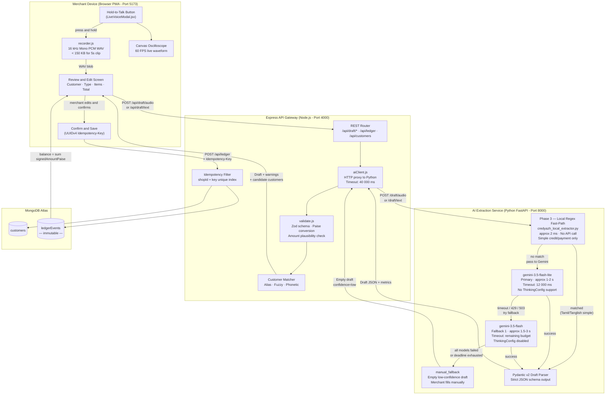
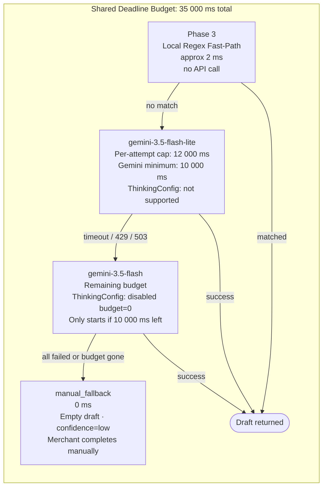
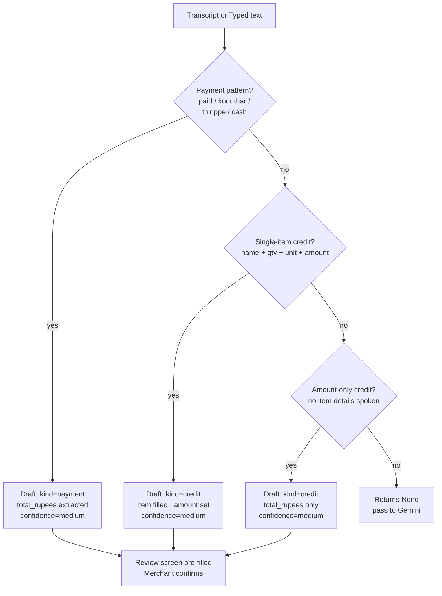
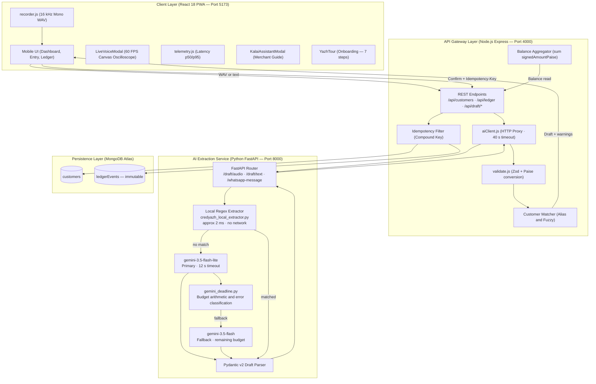
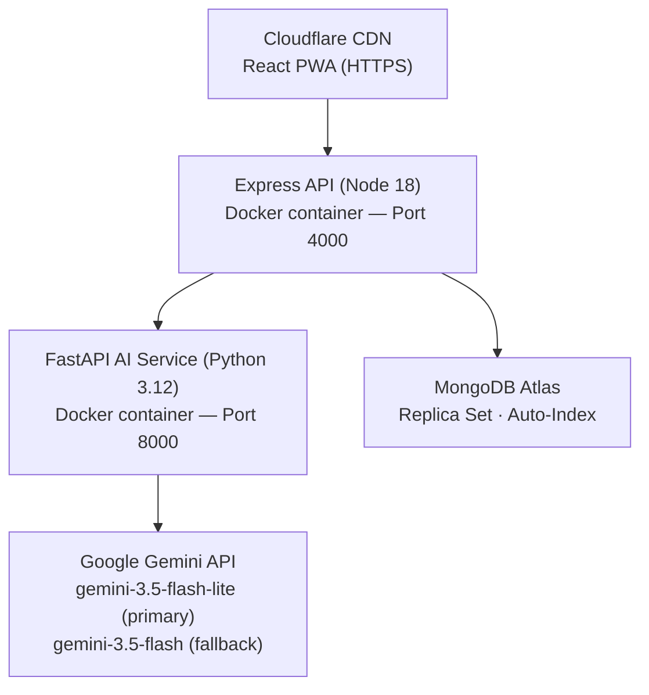

# CredYazh — System Architecture Specification

**Product:** CredYazh  
**Tagline:** *From voice to ledger instantly.*  
**Target Domain:** Micro-merchant / Kirana & Grocery Bookkeeping (India / Tamil Nadu)  
**Document Status:** Updated — reflects current prototype implementation (Oct 2026)

---

## 1. Executive Summary & Architectural Principles

CredYazh is a voice-first, multilingual credit ledger Progressive Web Application (PWA) designed for neighborhood grocery (*kirana*) merchants. It eliminates the cognitive and physical friction of manual paper notebooks (*katha*) and typing-heavy bookkeeping applications during rush hours.

### The Two-Gate Safety Architecture

Financial ledgers demand absolute trust and zero hallucination. CredYazh enforces a strict **Two-Gate Safety Architecture**:

1. **Gate 1 (Deterministic Validation Boundary):** Generative AI has zero direct access to the database and cannot commit transactions. It functions purely as an ephemeral linguistic parser, returning structured JSON drafts strictly conforming to schemas. The backend validates amounts, matches customers deterministically, flags anomalies, and preserves null prices when individual prices are not spoken.
2. **Gate 2 (Merchant Confirmation & Idempotency Boundary):** No financial entry is committed without explicit merchant inspection and confirmation on-screen. Once confirmed, transactions are recorded as immutable, append-only ledger events with integer-paise precision and compound idempotency keys.

---

## 2. How the Prototype Works — End-to-End Flow



---

## 3. AI Pipeline — Detailed Timing & Deadline Budget

The AI pipeline has **three layers** that run in order. Each layer has strict time limits enforced by `gemini_deadline.py`.



### Deadline Configuration (ai-service/.env)

| Variable | Current Value | Purpose |
|---|---|---|
| `AI_SHARED_DEADLINE_MS` | **35 000 ms** | Total wall-clock budget for one extraction (all attempts combined) |
| `GEMINI_REQUEST_TIMEOUT_MS` | **12 000 ms** | Per-attempt HTTP timeout sent to Gemini SDK |
| `GEMINI_MIN_ATTEMPT_BUDGET_MS` | **10 000 ms** | Do not start another model if less than this remains |
| `GEMINI_RATE_LIMIT_BACKOFF_MS` | **250 ms** | Wait after a 429 before retrying |
| `GEMINI_MAX_OUTPUT_TOKENS` | **1 024** | Cap output size for structured JSON drafts |

> **Important:** The Gemini API enforces a **minimum deadline of 10 seconds** per request. Any timeout value below 10 000 ms causes an immediate `400 INVALID_ARGUMENT`. Always keep `GEMINI_REQUEST_TIMEOUT_MS` ≥ 10 000 ms.

### Express → AI Timeout Chain (server/.env)

| Variable | Current Value | Rule |
|---|---|---|
| `AI_CLIENT_TIMEOUT_MS` | **40 000 ms** | Must be > `AI_SHARED_DEADLINE_MS` so Express can wait for Python to complete |

### Error Classification & Fallback Eligibility (`gemini_deadline.py`)

| Error Class | Examples | Triggers Fallback? |
|---|---|---|
| `timeout` | deadline exceeded, 504, read timeout | Yes |
| `rate_limit` | 429, RESOURCE_EXHAUSTED, quota | Yes (+ backoff wait) |
| `transient` | 503, UNAVAILABLE, 500, 502 | Yes |
| `auth` | 401, 403, UNAUTHENTICATED | No — raise immediately |
| `unknown` | any other (incl. 400 invalid args) | No — go straight to manual_fallback |

---

## 4. Phase 3 — Local Regex Fast-Path (Transcript-Based Ledger Drafting)

> **Yes — the system can draft a ledger entry by analysing the structure of the transcript without calling Gemini.** This is implemented in `credyazh_local_extractor.py` and is enabled by default (`ENABLE_LOCAL_EXTRACTOR=true`).

The local extractor runs **before** any Gemini call and covers the most common shopkeeper transcript patterns in Tamil, Tanglish, and English:



### What the local extractor handles

| Pattern | Example transcript | Result |
|---|---|---|
| Simple payment | `"Suresh 500 rupees paid"` | `kind=payment, total=500` |
| Tanglish payment | `"Kumar 300 kuduthutu"` | `kind=payment, total=300` |
| Single item credit | `"Ramu 2kg arisi 120 rupees"` | `kind=credit, item=Rice 2kg, total=120` |
| Amount-only credit | `"Priya 300 credit"` | `kind=credit, total=300` |
| Combined / multi-item | `"Kumar paid 200 and took rice and dal"` | Falls through to Gemini |

**Rules enforced by the extractor:**
- Never invents customer names, prices, or quantities
- Returns `None` (falls through to Gemini) when uncertain or ambiguous
- Always uses `confidence="medium"` — merchant must still confirm on review screen
- Combined transactions (payment + credit in one note) always fall through to Gemini

---

## 5. High-Level System Architecture



---

## 6. Recommended Tech Stack

| Tier | Technology | Version | Rationale |
|:---|:---|:---|:---|
| **Frontend** | React + Vite PWA | React 18.3+, Vite 5.4+ | Fast HMR, ~160 KB gzipped, native Web App Manifest for Android install |
| **Audio Capture** | Web Audio API | Native Browser | In-memory 16 kHz Mono PCM WAV via `AudioWorklet`; under 150 KB for 5 s |
| **Audio DSP** | HTML5 Canvas | Native | 60 FPS oscilloscope in `LiveVoiceModal.jsx` — no third-party chart libs |
| **Backend API** | Node.js + Express | Node 18+ LTS, Express 4.19+ | Lightweight async I/O; Zod validation, customer matching, DB coordination |
| **Validation** | Zod | 3.23+ | Strict runtime schema parsing, rupee-to-paise enforcement, anomaly checks |
| **AI Gateway** | Python + FastAPI | Python 3.12, FastAPI 0.111+ | Native Google GenAI SDK, Pydantic v2 schema enforcement, `temperature=0` |
| **Local Extractor** | Pure Python regex | Phase 3 | < 2 ms deterministic extraction for common patterns; zero API cost |
| **Primary AI** | gemini-3.5-flash-lite | — | ~1–2 s latency, lowest cost (~₹0.04/tx), no ThinkingConfig |
| **Fallback AI** | gemini-3.5-flash | — | ~1.5–3 s, ThinkingConfig disabled (`budget=0`), auto-triggered on timeout/429/503 |
| **Deadline Utils** | gemini_deadline.py | Phase 3 | Deadline budget arithmetic and error classification shared by main + orchestrator |
| **Database** | MongoDB Atlas | 7.0+ | Document model, compound idempotency index, aggregation for live balances |

---

## 7. Folder & Project Structure

```
credyazh/
├── ai-service/                          # Python 3.12 FastAPI AI Gateway
│   ├── .env                             # GEMINI_API_KEY, timeout config (current values)
│   ├── .env.example                     # Template for new environments
│   ├── requirements.txt                 # fastapi, uvicorn, google-genai, pydantic
│   ├── main.py                          # FastAPI app — routes, Gemini calls, failover loop
│   ├── gemini_deadline.py               # NEW — shared deadline utils & error classifier
│   ├── credyazh_local_extractor.py      # Phase 3 — regex fast-path (no Gemini call)
│   ├── failover_orchestrator.py         # Phase 2 multi-provider orchestrator (Groq backup)
│   └── tests/
│       ├── test_ask_deadline.py         # Deadline budget unit tests
│       ├── test_gemini_deadline.py      # Timeout arithmetic tests
│       └── test_failover_incident.py    # Failover scenario tests
│
├── client/                              # React 18 + Vite PWA
│   ├── public/
│   │   ├── manifest.webmanifest         # PWA install manifest
│   │   ├── icon-192.png
│   │   └── icon-512.png
│   └── src/
│       ├── App.jsx                      # Dashboard, tabs, Review UI
│       ├── LiveVoiceModal.jsx           # Push-to-talk + canvas oscilloscope
│       ├── KalaiAssistantModal.jsx      # Kalai AI guide modal (read-only)
│       ├── ArchivedCustomersModal.jsx   # Archived customer management
│       ├── YazhTour/                    # Onboarding tour (7 steps, localStorage)
│       │   └── index.jsx
│       ├── recorder.js                  # Web Audio API PCM WAV encoder
│       ├── telemetry.js                 # Client-side p50/p95 latency monitor
│       └── styles.css                   # Mobile-first Navy & Slate theme
│
├── server/                              # Node.js 18+ Express Backend
│   ├── src/
│   │   ├── index.js                     # Express bootstrap, Mongoose, index sync
│   │   ├── models.js                    # Mongoose: Customer & LedgerEvent schemas
│   │   ├── routes.js                    # REST routes: /customers, /ledger, /draft
│   │   ├── validate.js                  # Zod schemas, paise converters, warnings
│   │   └── aiClient.js                  # HTTP proxy to Python (40 s timeout)
│   └── test/
│       ├── validate.test.js
│       ├── customer_routes.test.js
│       ├── combined_live_api.test.js
│       └── gemini_latency.test.js
│
├── docs/yazh-tour/                      # YazhTour onboarding documentation
├── ARCHITECTURE.md                      # This document
├── DATABASE.md                          # Schema & financial invariants reference
├── API.md                               # REST endpoint contracts
└── README.md                            # Repository quick-start guide
```

---

## 8. Database Schema & Financial Invariants

CredYazh operates as an **event-sourced financial ledger**. Balances are never stored as mutable counters — they are always derived from immutable events via aggregation.

### `customers` Collection

```javascript
{
  shopId: String,           // tenant isolation key
  name: String,             // display name
  phone: String,            // optional
  aliases: [String],        // fuzzy match variants
  creditLimitPaise: Number, // 0 = unlimited
  archived: Boolean,        // soft-delete; blocked if balance is not 0
  createdAt: Date,
  updatedAt: Date
}
// Indexes: { shopId, name }, { shopId, phone }
```

### `ledgerEvents` Collection (Immutable Event Log)

```javascript
{
  shopId: String,
  customerId: ObjectId,
  type: 'CREDIT' | 'PAYMENT' | 'REVERSAL' | 'OPENING_BALANCE',
  signedAmountPaise: Number,  // positive = credit, negative = payment
  items: [{
    name: String,
    quantity: String,
    unit: String,
    pricePaise: Number | null  // null if price was not spoken
  }],
  notes: String,
  source: 'voice' | 'manual' | 'ai_assistant',
  idempotencyKey: String,     // UUIDv4 generated by client
  groupId: String | null,     // links atomic combined transactions
  reversesEventId: ObjectId | null,
  reversalReason: String | null,
  createdAt: Date
}
// Critical indexes:
// { shopId, idempotencyKey } UNIQUE
// { reversesEventId } UNIQUE partial — only when ObjectId type
```

### Core Financial Invariants

1. **Paise precision:** All money = positive integers. Floats rejected at API boundary with `HTTP 400`.
2. **Dynamic balance:** Sum of `signedAmountPaise` via `$group` aggregation — never a stored counter.
3. **Double-reversal immunity:** Partial unique index on `reversesEventId` — a second reversal raises MongoDB `11000` → `HTTP 409`.
4. **Settle-before-archive:** Customer with non-zero balance cannot be archived.

---

## 9. AI Engine Architecture

### Separation of Concerns

```
+--------------------------------------------------------------------+
|                        CREDYAZH PLATFORM                          |
+-----------------------------------+--------------------------------+
| Voice Transaction Engine          | Kalai AI Merchant Assistant    |
+-----------------------------------+--------------------------------+
| Headless FastAPI Gateway          | React Modal UI                 |
| Local regex fast-path (< 2 ms)    | Tamil / English guidance       |
| Gemini primary + fallback chain   | Explains balances & terms      |
| ZERO database access              | Read-only; cannot post ledger  |
| Strict Pydantic v2 schema output  | 7-step onboarding walkthrough  |
+-----------------------------------+--------------------------------+
```

### Gemini Draft Output Schema (Pydantic v2)

```python
class Item(BaseModel):
    name: str
    quantity: Optional[float] = None
    unit: Optional[str] = None
    price_rupees: Optional[float] = None   # null if price not spoken

class Operation(BaseModel):
    type: Literal["payment", "credit"]
    items: list[Item] = []
    total_rupees: Optional[float] = None

class Draft(BaseModel):
    kind: Literal["credit", "payment", "combined"] = "credit"
    customer_name: str = ""
    items: list[Item] = []
    total_rupees: Optional[float] = None
    operations: list[Operation] = []   # populated for kind="combined"
    transcript: str = ""
    confidence: Literal["high", "medium", "low"] = "high"
```

### Unit Economics

- Prompt: ~320 input tokens | Output: ~95 tokens
- Cost on `gemini-3.5-flash-lite`: **~₹0.04 per voice draft**
- Average merchant: 500 drafts/month = **₹20/month**
- At ₹299/month subscription: AI cost = **< 7% of revenue** (> 90% gross margin)

---

## 10. API Architecture & Contracts

| Method | Endpoint | Description |
|:---|:---|:---|
| `POST` | `/api/draft/audio` | WAV blob → structured Draft JSON |
| `POST` | `/api/draft/text` | Typed text → structured Draft JSON |
| `GET` | `/api/customers` | List active customers with live balances |
| `POST` | `/api/customers` | Create customer with name & aliases |
| `GET` | `/api/customers/:id/ledger` | Statement & transaction history |
| `POST` | `/api/ledger` | Commit confirmed draft (Idempotency-Key header) |
| `POST` | `/api/ledger/:id/reverse` | Reverse entry with audit reason |
| `POST` | `/api/draft/whatsapp-message` | Generate bilingual WhatsApp statement |

### Canonical Draft JSON (Gate 1 Response)

```json
{
  "customerName": "Kumar",
  "matchedCustomerId": "6627a1b0c9e123456789abcd",
  "candidateCustomers": [],
  "items": [
    { "name": "Rice", "quantity": "0.5", "unit": "kg", "pricePaise": null },
    { "name": "Milk", "quantity": "1",   "unit": "L",  "pricePaise": null }
  ],
  "totalPaise": 16000,
  "intent": "CREDIT",
  "warnings": [],
  "rawTranscript": "Kumar account-la arai kilo arisi, oru litre paal, total 160 rupees"
}
```

---

## 11. Security Boundaries

| Threat | Mitigation |
|:---|:---|
| API key leakage | Keys in `.env` only; multi-tier `.gitignore`; zero keys in frontend |
| AI writing to DB | AI service has no MongoDB driver — physically cannot write |
| DoS / large payloads | Express: `100 kb` JSON limit; Multer: `5 MB` audio limit |
| Double-billing | Client UUIDv4 idempotency key + unique DB compound index |
| Race conditions on balance | Dynamic aggregation sum — no stored mutable counter |
| Cross-tenant data leak | All queries scoped by `req.shopId` middleware |

---

## 12. Environment Configuration

### `ai-service/.env` (current values)

```ini
GEMINI_API_KEY=<your_gemini_key>
GEMINI_MODELS=gemini-3.5-flash-lite,gemini-3.5-flash

# Deadline budget — must be >= GEMINI_REQUEST_TIMEOUT_MS
AI_SHARED_DEADLINE_MS=35000

# Per-attempt cap — Gemini API minimum is 10 000 ms
GEMINI_REQUEST_TIMEOUT_MS=12000

# Minimum remaining budget to start another attempt
GEMINI_MIN_ATTEMPT_BUDGET_MS=10000

GEMINI_RATE_LIMIT_BACKOFF_MS=250
GEMINI_MAX_OUTPUT_TOKENS=1024
ENABLE_LOCAL_EXTRACTOR=true

# Phase 2 (disabled until approved)
AI_FAILOVER_ENABLED=false
```

### `server/.env`

```ini
PORT=4000
MONGODB_URI=mongodb+srv://<user>:<pass>@cluster.mongodb.net/credyazh
AI_SERVICE_URL=http://127.0.0.1:8000

# Must be > AI_SHARED_DEADLINE_MS
AI_CLIENT_TIMEOUT_MS=40000
```

---

## 13. Error Handling & Observability

### Standardized Error Envelope

```json
{
  "error": "Cannot archive customer with active balance",
  "code": "CUSTOMER_BALANCE_NON_ZERO",
  "details": { "currentBalancePaise": 37000 }
}
```

### Latency Observability

- **W3C `Server-Timing` headers** on every draft response:
  ```
  Server-Timing: total;dur=1438, ai;dur=1210, db;dur=12, gemini;dur=1180
  ```
- **`telemetry.js`** tracks rolling p50 / p95 / min / max / avg client-side
- **AI metrics payload** returned inside every draft response:
  ```json
  {
    "metrics": {
      "model": "gemini-3.5-flash-lite",
      "gemini_latency_ms": 1086,
      "ai_total_latency_ms": 1090,
      "deadline_ms": 35000,
      "models_attempted": [
        { "model": "gemini-3.5-flash-lite", "status": "ok", "latency_ms": 1086 }
      ]
    }
  }
  ```

---

## 14. Testing Strategy & Deployment

### Test Matrix

| Test file | What it covers |
|---|---|
| `validate.test.js` | Paise math, float rounding immunity, Zod schema constraints, anomaly flags |
| `customer_routes.test.js` | Customer lifecycle, balance checks, alias search, soft-delete |
| `combined_live_api.test.js` | End-to-end voice-to-draft, combined atomic batches, idempotency retry |
| `gemini_latency.test.js` | Model cascade, FastAPI health, Server-Timing validation |
| `test_ask_deadline.py` | Deadline budget arithmetic, fallback triggering |
| `test_gemini_deadline.py` | Error classification, timeout computation |
| `test_failover_incident.py` | Multi-model incident scenarios |

### Deployment Topology



### Staging vs. MVP

- **MVP (current):** Single cloud VM or Railway / Render / Cloud Run; single demo shop; `shopId = 'demo-shop'`.
- **Phase 2:** Multi-tenant JWT auth, Redis session cache, IndexedDB offline sync, WhatsApp Cloud API webhooks, Groq secondary AI provider.
