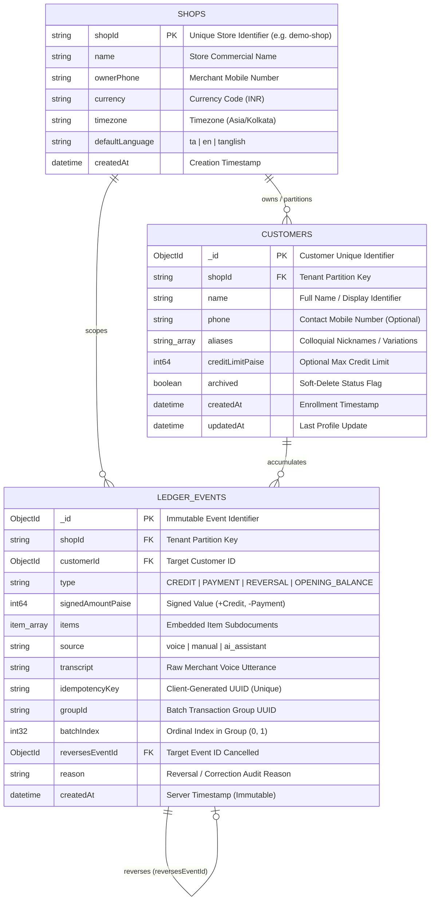

# CredYazh — Database Architecture & Data Model Specification (DATABASE.md)

**Product:** CredYazh  
**Tagline:** *From voice to ledger instantly.*  
**System Role:** Voice-First Multilingual Kirana & Grocery Ledger  
**Document Status:** Production Database Blueprint (Derived from `FrontPage-CY_merged.md` and `ARCHITECTURE.md`)  

---

## 1. Database Technology & Architectural Rationale

CredYazh utilizes **MongoDB Atlas (v7.0+ Replica Set)** as its system of record. The core architectural paradigm is **Append-Only Event Sourcing** coupled with dynamic aggregation.

### Why MongoDB Over Traditional Relational / Key-Value Stores:
1. **Dynamic Itemized Grocery Payloads:** Kirana purchases vary widely from zero itemized line-items (spoken aggregate bill total only) to multi-item baskets with variable fractional units (`0.5 kg`, `1 litre`, `2 packets`). Document structures support embedded subdocuments without expensive relational table joins on high-frequency counter transactions.
2. **Append-Only Immutable Event Sourcing:** Financial ledgers require audit-proof persistence. Instead of updating mutable account balances, every financial interaction is appended as an immutable event.
3. **Compound & Partial Unique Indexes:** MongoDB natively supports partial filter expressions (`partialFilterExpression`), which enables zero-cost indexing for idempotent retries and guarantees single-reversal enforcement at the storage engine level.
4. **Native Aggregation Pipelines:** Dynamically aggregating customer balances across hundreds of transactions via covered index pipelines takes $< 15\text{ ms}$, eliminating balance cache desynchronization bugs.
5. **Multi-Document ACID Transactions:** Multi-operation voice statements (e.g., *"Customer paid ₹200 cash and took ₹70 credit"*) are committed atomically in a single session across collections.

---

## 2. Entity-Relationship (ER) Diagram



---

## 3. Detailed Collections & Schema Specification

All monetary values are strictly represented in **64-bit integer paise** ($1\text{ Rupee} = 100\text{ paise}$). Floating-point data types are strictly prohibited in the persistence layer.

### 3.1. `shops` Collection (Tenant Isolation Root)
Defines merchant store ownership, regional configuration, and operational bounds.

| Field Name | BSON Type | Constraints & Validation | Description |
| :--- | :--- | :--- | :--- |
| `_id` | `ObjectId` | Primary Key (`auto`) | Internal document ID |
| `shopId` | `String` | Unique, Required, Trimmed | Immutable merchant slug / tenant partition ID (e.g. `demo-shop`) |
| `name` | `String` | Required, Max 120 chars | Registered name of the kirana store |
| `ownerPhone` | `String` | Required, E.164 format (`+91...`) | Primary phone number for merchant authentication |
| `currency` | `String` | Default: `'INR'`, Enum: `['INR']` | Minor-unit base currency |
| `timezone` | `String` | Default: `'Asia/Kolkata'` | Store operational timezone |
| `defaultLanguage` | `String` | Enum: `['ta', 'en', 'tanglish']` | Primary UI and voice recognition language |
| `plan` | `String` | Default: `'starter'`, Enum: `['starter', 'pro']` | Subscription tier |
| `createdAt` | `Date` | Required, Default: `Date.now` | Store onboarding timestamp |

### 3.2. `customers` Collection
Maintains customer profiles, contact metadata, colloquial aliases, and lifecycle states.

| Field Name | BSON Type | Constraints & Validation | Description |
| :--- | :--- | :--- | :--- |
| `_id` | `ObjectId` | Primary Key (`auto`) | Unique customer reference |
| `shopId` | `String` | Required, Indexed | Tenant partition key linking to `shops.shopId` |
| `name` | `String` | Required, Min 1, Max 100 chars | Customer name as spoken or entered by shopkeeper |
| `phone` | `String` | Optional, Trimmed | 10-digit mobile number for WhatsApp statement dispatch |
| `aliases` | `Array<String>` | Array of strings, Lowercased | Local nicknames (e.g. `["Ravi tea shop", "Annachi"]`) |
| `creditLimitPaise` | `Int64` | Default: `0` (0 = no limit enforced) | Max outstanding credit limit before triggering on-screen warnings |
| `archived` | `Boolean` | Default: `false`, Indexed | Soft-deletion flag. Allowed only when balance is exactly ₹0.00 |
| `createdAt` | `Date` | Default: `Date.now` | Profile creation timestamp |
| `updatedAt` | `Date` | Default: `Date.now` | Profile modification timestamp |

### 3.3. `ledgerEvents` Collection (System of Record)
The append-only financial ledger. Documents in this collection are **strictly immutable**; updates (`$set`) and deletions (`deleteOne`/`deleteMany`) are forbidden in application logic.

| Field Name | BSON Type | Constraints & Validation | Description |
| :--- | :--- | :--- | :--- |
| `_id` | `ObjectId` | Primary Key (`auto`) | Unique immutable event ID |
| `shopId` | `String` | Required, Indexed | Tenant partition key |
| `customerId` | `ObjectId` | Required, Ref: `Customer`, Indexed | Associated customer document reference |
| `type` | `String` | Enum: `['CREDIT', 'PAYMENT', 'REVERSAL', 'OPENING_BALANCE']` | Financial event classification |
| `signedAmountPaise` | `Int64` | Required, Non-zero integer | Signed value: `+` for credit debt, `-` for payment reduction |
| `items` | `Array<Item>` | Embedded documents (see below) | List of provisions purchased |
| `source` | `String` | Enum: `['voice', 'manual', 'ai_assistant']` | Mode of transaction entry |
| `transcript` | `String` | Optional, Max 1,000 chars | Original merchant spoken phrase (for audit verification) |
| `idempotencyKey` | `String` | Required, Max 100 chars, Unique per shop | Client-generated UUID preventing duplicate commits |
| `groupId` | `String` | Optional, Indexed | Shared UUID grouping multi-operation atomic interactions |
| `batchIndex` | `Int32` | Default: `0`, Min: `0` | Sequence order within compound batch |
| `reversesEventId` | `ObjectId` | Optional, Ref: `LedgerEvent`, Partial Unique | Points to original event neutralized by this reversal |
| `reason` | `String` | Mandatory when `type == 'REVERSAL'` | Audit justification for undo or correction |
| `createdAt` | `Date` | Required, Default: `Date.now`, Immutable | Exact server commit timestamp |

#### Embedded `items` Subdocument Schema:
```json
{
  "name": "paruppu",
  "quantity": "0.5",
  "unit": "kg",
  "pricePaise": null
}
```
- `name` (`String`, Required): Product description as spoken.
- `quantity` (`String`, Optional): Amount purchased (stored as string to accommodate vulgar fractions like `"1/2"` or `"0.5"`).
- `unit` (`String`, Optional): Unit of measurement (`kg`, `litre`, `packet`, `bundle`, `piece`).
- `pricePaise` (`Int64`, Optional, Default: `null`): Explicit line price in paise. **Null Price Safety rule:** strictly `null` if the merchant spoke only a total bill amount, preventing fabricated item-level pricing.

---

## 4. Primary Keys, Foreign Keys & Relationships

```
┌─────────────────────────────────┐
│              SHOPS              │
│  PK: shopId                     │
└────────────────┬────────────────┘
                 │ 1
                 │
                 │ 1..*
┌────────────────┴────────────────┐          1..* ┌─────────────────────────────────┐
│            CUSTOMERS            ├───────────────┤          LEDGER_EVENTS          │
│  PK: _id                        │               │  PK: _id                        │
│  FK: shopId ──> SHOPS.shopId    │               │  FK: shopId ──> SHOPS.shopId    │
└─────────────────────────────────┘               │  FK: customerId ──> CUSTOMER._id│
                                                  │  FK: reversesEventId ──> SELF._id│
                                                  │  Logical Link: groupId (Batch)  │
                                                  └─────────────────────────────────┘
```

1. **`customers.shopId` $\longrightarrow$ `shops.shopId`:** Logical foreign key ensuring all customer profiles belong to a discrete tenant boundary.
2. **`ledgerEvents.customerId` $\longrightarrow$ `customers._id`:** Referential foreign key binding every ledger transaction to an active customer.
3. **`ledgerEvents.reversesEventId` $\longrightarrow$ `ledgerEvents._id`:** Self-referential foreign key for non-destructive financial cancellations.
4. **`ledgerEvents.groupId` (Logical Correlation):** Correlates linked operations generated from a single spoken phrase (e.g. `batchIndex: 0` = Cash Repayment, `batchIndex: 1` = Credit Purchase).

---

## 5. Constraints & Data Integrity Invariants

### 1. Integer-Only Monetary Arithmetic
Floating point representations (`0.1`, `0.2`) produce binary rounding anomalies (`0.30000000000000004`). CredYazh enforces integer paise across all operations:
- Minimum unit: $1\text{ paisa} = \text{₹}0.01$.
- Maximum transaction limit: $100,000,000\text{ paise} = \text{₹}1,000,000.00$.
- Validation: Zod schema rejects floats via `z.number().int().positive()`.

### 2. Append-Only Balance Invariant
Customer balances are never updated in place. Balances are derived dynamically by summing all signed events:
$$\text{Current Balance} = \sum_{e \in \text{LedgerEvents}} e.\text{signedAmountPaise}$$
- $\text{CREDIT} \implies \text{signedAmountPaise} > 0$
- $\text{PAYMENT} \implies \text{signedAmountPaise} < 0$
- $\text{REVERSAL} \implies \text{signedAmountPaise} = -e_{\text{target}}.\text{signedAmountPaise}$

### 3. Double-Reversal Immunity
A ledger event can only be reversed **once**. A partial unique index on `reversesEventId` guarantees that a second reversal attempt triggers a MongoDB unique constraint violation (`E11000`), translated to `HTTP 409 Conflict`:
```javascript
ledgerEventSchema.index(
  { reversesEventId: 1 },
  { unique: true, partialFilterExpression: { reversesEventId: { $type: 'objectId' } } }
);
```

### 4. Non-Reversible Reversals
Application logic explicitly rejects any reversal request targeting an event where `type === 'REVERSAL'` (`HTTP 409: a reversal cannot be reversed`).

### 5. Settle-Before-Delete Rule
To protect merchants from accidental debt erasure, a customer cannot be archived if their dynamic balance $\neq 0$:
```javascript
const bal = (await balances()).get(customerId) || 0;
if (bal !== 0) {
  throw new Error("Cannot delete customer with active balance. Settle balance first.");
}
```

---

## 6. Query-Driven Indexing Strategy

Indexes are explicitly mapped to high-traffic application access patterns to guarantee all customer operations execute under **20 ms**:

| Index Specification | Partial / Compound Details | Covered Query / Access Pattern |
| :--- | :--- | :--- |
| `{ shopId: 1, archived: 1, name: 1 }` | Compound Index | **Customer Directory:** `GET /customers` — sorts active customers by name filtered by store. |
| `{ shopId: 1, customerId: 1, createdAt: -1 }` | Compound Descending | **Customer Statement:** `GET /customers/:id/ledger` — retrieves chronological history with latest transactions first. |
| `{ shopId: 1, customerId: 1, signedAmountPaise: 1 }` | Compound Index | **Covered Balance Aggregation:** Dynamic `$group` pipeline summing balances without loading full documents into memory. |
| `{ shopId: 1, idempotencyKey: 1 }` | Compound Unique, Partial: `{ idempotencyKey: { $type: "string" } }` | **Double-Billing Protection:** `POST /ledger` — prevents duplicate submissions from network retries or double taps. |
| `{ shopId: 1, groupId: 1 }` | Compound, Partial: `{ groupId: { $type: "string" } }` | **Combined Batch Lookup:** Resolves multi-operation compound submissions (`POST /ledger` verification). |
| `{ reversesEventId: 1 }` | Unique, Partial: `{ reversesEventId: { $type: "objectId" } }` | **Double-Reversal Guard:** Ensures an event is neutralized exactly once. |
| `{ shopId: 1, phone: 1 }` | Compound Sparse | **Customer Lookup by Phone:** Quick match when merchant provides or searches customer phone numbers. |

---

## 7. Ownership, Multi-Tenancy & Row-Level Security (RLS)

### Logical Tenant Partitioning
In MongoDB, logical Row-Level Security (RLS) is achieved through tenant scoping enforced at the data layer:
1. Every collection document carries an immutable `shopId`.
2. **Tenant Boundary Middleware:** Application controllers automatically extract `shopId` from verified merchant session/token:
   ```javascript
   // Mandatory query filter pattern across all repository operations:
   const filter = { shopId: req.shopId, ...userQuery };
   ```
3. **Cross-Tenant Access Prevention:** Even if an attacker supplies a valid `customerId` belonging to Shop B, the query `{ _id: customerId, shopId: "Shop-A" }` returns `null` (`HTTP 404 Not Found`).

### Role-Based Access Control (RBAC) Matrix

| Operation | Store Owner | Shop Staff (Clerk) | Kalai AI Assistant |
| :--- | :---: | :---: | :---: |
| Record Voice / Manual Credit | Yes | Yes | Propose Draft Only |
| Record Cash Repayment | Yes | Yes | Propose Draft Only |
| Immediate Undo ($\le 5\text{ seconds}$) | Yes | Yes | No |
| Reverse Historical Entry ($> 15\text{ mins}$) | Yes | No (Owner PIN Required) | No |
| Archive / Delete Settled Customer | Yes | No | No |
| Export Accounting Statement | Yes | No | Read-Only Summary |

---

## 8. Sensitive-Data Handling & Privacy

1. **Ephemeral Voice Audio:** Raw PCM WAV audio sent for transcription is processed strictly in-memory (`Multer` RAM storage). **No audio recordings are written to disk or stored long-term in the database.**
2. **Transcript Retention:** Spoken text is stored in `ledgerEvents.transcript` exclusively to provide an audit trail during merchant-customer balance disputes. Transcripts older than 90 days can be pruned via automated TTL scripts if merchant consent mandates.
3. **PII Minimization:** Customer records require only a `name`. Phone numbers are optional and collected solely for merchant-initiated WhatsApp sharing (`wa.me` deep links).
4. **Transport & Storage Encryption:**
   - Transport: Enforced TLS 1.3 for all client-to-API and API-to-Atlas connections.
   - Rest: AES-256 encryption at rest enabled by default across MongoDB Atlas volumes.

---

## 9. Migration & Seed Strategy

### Database Versioning & Migrations
Database schema evolutions are managed via `migrate-mongo`:
- Migration files reside in `credyazh/server/migrations/`.
- Migrations must be non-destructive and backward-compatible (e.g. adding optional fields with defaults).
- Reversals and historical events are never migrated destructively.

### Opening Balance Migration from Paper Notebooks
When a merchant transitions from physical paper notebooks (*katha*) to CredYazh, existing customer debts are imported as explicit opening events:
```json
{
  "shopId": "demo-shop",
  "customerId": "6627a1b0c9e123456789abcd",
  "type": "OPENING_BALANCE",
  "signedAmountPaise": 75000,
  "items": [],
  "source": "manual",
  "notes": "Opening balance migrated from physical khata notebook",
  "idempotencyKey": "migration-initial-kumar-750"
}
```
*Rule:* Opening balance is an auditable, merchant-confirmed event, not an untraced database counter overwrite.

### Deterministic Seed Dataset
For testing and demo environments, seed scripts populate canonical Kirana fixtures:
- `Kumar` (Regular customer, active balance ₹370.00)
- `Ramesh Kumar` (Separate customer to verify disambiguation logic)
- `Lakshmi Amma` (Zero balance regular)
- `Murugan Store Regular` (Settled customer demonstrating archive/restore workflow)

---

## 10. Backup, High Availability & Disaster Recovery

| Disaster Recovery Metric | Target Objective | Implementation Mechanism |
| :--- | :--- | :--- |
| **Recovery Point Objective (RPO)** | $\le 1\text{ hour}$ | MongoDB Atlas Continuous Cloud Backups with Point-in-Time Recovery (PITR) enabled. |
| **Recovery Time Objective (RTO)** | $\le 15\text{ minutes}$ | Automated multi-region replica failover; one-click cluster restoration from snapshot. |
| **Write Concern** | `w: "majority"` | Ensures ledger events are acknowledged by a majority of replica set nodes before returning `HTTP 201`. |
| **Read Concern** | `"majority"` | Prevents dirty reads during temporary network partitions. |
| **High Availability Topology** | 99.95% Uptime | 3-Node Replica Set (Primary + 2 Secondary nodes) across separate availability zones. |
| **Cold Storage Export** | Weekly | Automated nightly BSON dumps (`mongodump`) compressed and archived in secure, encrypted cloud object storage. |
